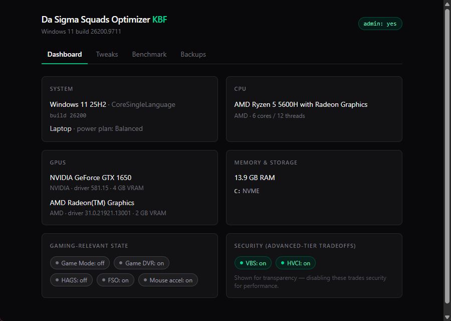
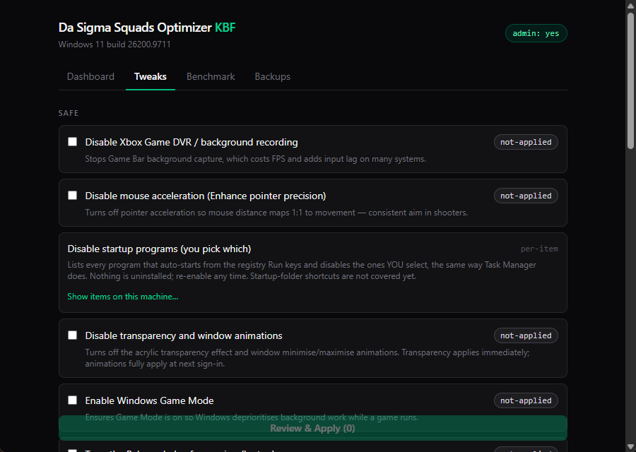
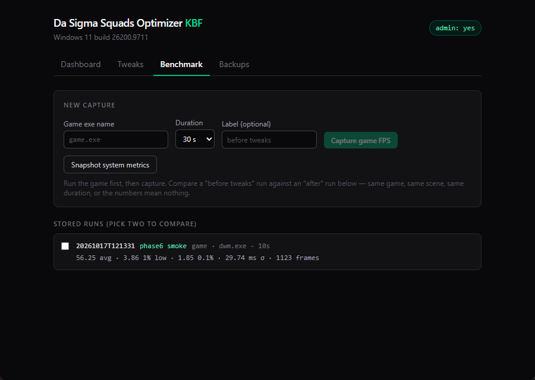

# Da Sigma Squads Optimizer KBF

A Windows 11 gaming optimizer that profiles your hardware, recommends tweaks **specific to your machine**, applies them with full backup + revert, and **proves the result** with before/after benchmarks.

Tauri 2 (Rust + React/TypeScript) GUI and a `dsso-cli.exe` console tool, both wrapping the same PowerShell tweak engine.

## Principles (non-negotiable)

1. **Reversible** — every tweak has a tested `Revert`; nothing is applied without a backup of the exact prior state (plus a System Restore Point attempt per session).
2. **Honest** — no snake oil: no RAM cleaners, no "core unparking", no registry cleaners, no claims we can't measure. When a change makes things worse, the benchmark page says **WORSE**.
3. **Specific** — tweaks are gated on detected hardware/OS. No NVIDIA tweaks on AMD machines, no laptop power tweaks on desktops.
4. **Safe by default** — the default profile is safe-tier only; caution/advanced tiers are opt-in with explicit warnings, and the advanced tier requires an "I understand" confirmation.
5. **Transparent** — dry-run shows exactly which registry values, services, or power settings will change before anything runs. Everything logs to `%LOCALAPPDATA%\dsso-kbf\logs`.

## Screenshots





## What it tweaks

**Safe tier:** Game DVR off, Game Mode on, power plan (High performance on desktops / tuned Balanced on laptops), mouse acceleration off, startup programs (you pick each), preinstalled-app removal (you pick each; Game Pass apps deliberately excluded), trimmed visual effects, transparency/animations off.

**Caution tier (opt-in):** HAGS as a real on/off toggle with a hardware-based recommendation, Fullscreen Optimizations global default, Nagle's algorithm per network adapter (honestly labeled: TCP-only), background services to Manual (SysMain, DiagTrack, Print Spooler only when no printer is detected).

**Advanced tier (opt-in + explicit confirmation):** VBS/HVCI off — a real security tradeoff, documented as such.

Deliberately **not** implemented: RAM cleaning, core unparking, timer-resolution hacks, CPU-mitigation disabling, registry "cleaning" — and the NVIDIA low-latency/max-performance tweak is deferred until it can be done honestly through NVAPI instead of fake registry pokes.

## Benchmarks

Bundled Intel [PresentMon](https://github.com/GameTechDev/PresentMon) (v2.6.0, signed by Intel) captures frametimes of a running game. Stats method, stated plainly: avg FPS = 1000 / mean frametime; **1% low** = 1000 / mean of the worst 1% of frametimes (0.1% analogous). The raw CSV is kept next to each run so numbers can be re-checked. Cheap system metrics (idle CPU %, RAM, last boot time from the event log) are captured separately. Compare any two runs of the same kind side by side.

## Install / run

- **Windows 11 only** (build 22000+). The app refuses older builds.
- **Runs elevated** — tweaks touch HKLM, services and power settings. Both exes carry a `requireAdministrator` manifest.
- Installer: `dsso-kbf_<version>_x64-setup.exe` (NSIS). Currently **unsigned**, so SmartScreen will warn — release signing via Azure Trusted Signing is planned.
- Everything the app writes lives under `%LOCALAPPDATA%\dsso-kbf\` (logs, backups, benchmarks).

## CLI

```
dsso-cli profile                          print the detected SystemProfile JSON
dsso-cli list [--tier safe|caution|advanced]
dsso-cli dry-run <profile|tweak-id...>    show exactly what would change
dsso-cli apply <profile|tweak-id...>      backup + apply (one revertible session)
dsso-cli revert <session-id|all>
dsso-cli bench --exe game.exe --duration 30 [--label "before"]
dsso-cli bench --system
```

Run it from an **elevated** terminal (the admin manifest applies to the CLI too). List-driven tweaks need `DSSO_KBF_ITEMS`, the HAGS toggle needs `DSSO_KBF_TARGET=on|off` — or use the GUI, which has checkboxes for both.

The NSIS installer currently ships the GUI only; `dsso-cli.exe` comes from the CI "portable" artifact or a source build (it lands next to the GUI exe in `src-tauri\target\release`).

## Building from source (CMD)

```
npm install
npm run tauri dev          (elevated terminal required)
npm run tauri build        (release exe + NSIS installer)
cargo test --lib --manifest-path src-tauri\Cargo.toml
powershell -NoProfile -Command "Invoke-Pester tests\pester"
```

One-time: `powershell -NoProfile -Command "Install-Module Pester -Force -SkipPublisherCheck"` (the inbox Pester 3.4 is too old).

See [CLAUDE.md](CLAUDE.md) for the full spec: the tweak module contract, list-driven/toggle extensions, backup format, and testing requirements.
